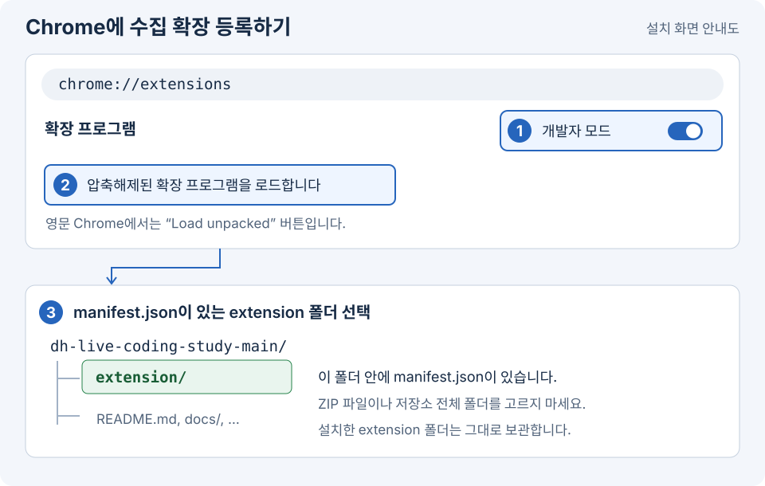
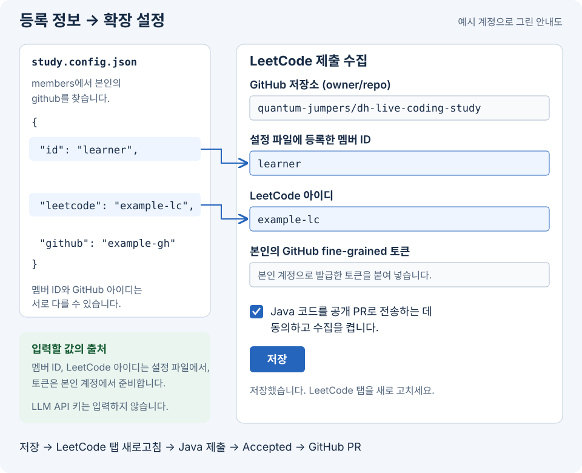

# DH live coding study

정답 판정을 받은 Java 제출 원문을 GitHub PR에 기록하고, PR 댓글에서 영어 모의 면접을 진행합니다. GitHub Actions가 [공개용 코칭 스킬](skills/java-live-coding-coach/SKILL.md)과 제출 코드를 LLM API에 전달하므로 별도 서버를 운영할 필요가 없습니다.

## 참여자 설정

문제를 제출하는 사람은 대표자도 아래 설정이 필요합니다. 본인의 GitHub 계정으로 조직 초대를 수락하고, 대표자에게 저장소 Write 권한과 [study.config.json](study.config.json)의 참여자 등록을 확인받으세요. 참여자는 LLM API 키를 발급받지 않습니다.

### 1. 확장 파일 받기

[최신 main ZIP 받기](https://github.com/dh-live-coding-study/dh-live-coding-study/archive/refs/heads/main.zip)를 눌러 압축을 풉니다. 저장소의 **Code → Download ZIP**으로 받아도 됩니다. 이미 저장소를 clone했다면 최신 main의 파일을 사용합니다.

압축을 푼 폴더 안의 **`extension/`**에 `manifest.json`이 있는지 확인하세요. 이 폴더를 Chrome이 계속 읽으므로 설치 후에도 지우거나 옮기지 않습니다. 별도 빌드나 npm 설치는 필요 없습니다.

### 2. Chrome에 등록하기

1. 새 탭의 주소창에 `chrome://extensions`를 입력합니다.
2. 오른쪽 위 **개발자 모드(Developer mode)**를 켭니다.
3. **압축해제된 확장 프로그램을 로드합니다(Load unpacked)**를 누르고 `extension/` 폴더를 선택합니다. ZIP 파일이나 저장소 전체 폴더를 선택하면 안 됩니다.
4. 목록에 **DH LeetCode submission collector**가 나타나고 사용 상태가 켜져 있는지 확인합니다.



위 그림은 설치 위치를 표시한 안내도입니다. Chrome 버전과 언어에 따라 버튼 표시는 다를 수 있습니다. 설치 절차는 [Chrome 공식 안내](https://developer.chrome.com/docs/extensions/get-started/tutorial/hello-world#load-unpacked)를 참고할 수 있습니다.

### 3. 본인의 GitHub 토큰 만들기

[Fine-grained personal access token 만들기](https://github.com/settings/personal-access-tokens/new)를 엽니다. 토큰 이름은 알아보기 쉽게 정하고 만료일을 선택한 뒤, 아래와 같이 설정합니다.

| 항목 | 선택할 값 |
| --- | --- |
| Resource owner | `dh-live-coding-study` 조직 |
| Repository access | **Only select repositories** → `dh-live-coding-study` 저장소 |
| Repository permissions → Actions | **Read and write** |
| Repository permissions → Contents | **Read-only** |
| Repository permissions → Pull requests | **Read-only** |

**Generate token**으로 발급한 값을 다음 단계의 토큰 입력란에 넣습니다. 토큰은 다시 볼 수 없으므로 본인만 사용하는 비밀번호 관리자 등에 보관하고, 채팅이나 PR에 붙여 넣지 마세요. 조직 승인을 요구하는 경우 `pending` 상태에서는 전송할 수 없으므로 대표자에게 승인을 요청합니다. 조직이 Resource owner에 보이지 않으면 초대 수락 여부와 조직의 토큰 정책을 대표자에게 확인하세요. [GitHub 토큰 안내](https://docs.github.com/en/authentication/keeping-your-account-and-data-secure/managing-your-personal-access-tokens)

### 4. 수집 설정 저장하기

Chrome 도구 모음의 **확장 프로그램(퍼즐 아이콘)**에서 **DH LeetCode submission collector**를 누르면 설정 화면이 열립니다. 자주 사용한다면 핀 아이콘으로 고정해 두세요.

[study.config.json](study.config.json)의 `members`에서 **본인의 GitHub 아이디(`github`)가 있는 항목**을 찾습니다. 아래 `learner`, `example-lc`, `example-gh`는 설명용 예시이므로 본인의 등록값으로 바꿉니다.



| 확장 입력란 | 입력할 값 |
| --- | --- |
| GitHub 저장소 (owner/repo) | `dh-live-coding-study/dh-live-coding-study` |
| 설정 파일에 등록한 멤버 ID | 본인 항목의 **`id`**. GitHub 아이디와 다를 수 있습니다. |
| LeetCode 아이디 | 같은 항목의 **`leetcode`**. 실제 제출할 LeetCode 계정입니다. |
| 본인의 GitHub fine-grained 토큰 | 3단계에서 본인 GitHub 계정으로 발급한 토큰 |

**Java 코드를 공개 PR로 전송하는 데 동의하고 수집을 켭니다**를 체크하고 **저장**을 누릅니다. `저장했습니다. LeetCode 탭을 새로 고치세요.`라는 문구가 나오면 LeetCode 탭을 새로 고칩니다. 이 저장 메시지는 입력 형식 확인 결과이며, GitHub 권한과 실제 전송은 첫 제출에서 확인합니다.

### 5. 첫 정답 제출하기

등록한 LeetCode 계정으로 Java 풀이를 **Submit**하고 **Accepted** 판정을 기다립니다. **Run**만 누른 경우와 설치 전에 제출한 과거 풀이는 수집하지 않습니다.

확장 설정 화면의 **새로 고침**을 눌러 **대기 중인 제출**과 **PR 생성 확인 이력**을 갱신합니다. 처리가 끝난 제출의 PR 링크가 이력에 나타나면 `Solution.java`를 확인합니다. 첫 면접 질문에 영어 댓글로 답하면 다음 질문이 이어집니다.

| 멈춘 위치 | 확인할 곳 |
| --- | --- |
| 대기 목록에 제출이 없음 | 확장 화면의 **새로 고침**을 먼저 누릅니다. 그래도 없다면 수집 동의와 저장 여부, LeetCode 탭 새로고침, 제출 언어가 Java인지 확인합니다. |
| 판정 대기 중 | 로그인한 LeetCode 탭을 열고 **판정 재확인**을 누릅니다. |
| 전송 실패 | 토큰 만료, 조직 승인, 권한과 등록 계정을 확인한 뒤 **다시 전송**을 누릅니다. |
| 실행 요청은 접수됐지만 PR이 없음 | **Actions 확인**에서 실행 결과를 확인합니다. PR이 생겼다면 **PR 확인**으로 다시 조회합니다. |

### 업데이트하기

최신 main을 받아 설치한 `extension/` 폴더를 갱신하고, `chrome://extensions`의 수집 확장 카드에서 **새로고침**을 누릅니다. 이어서 LeetCode 탭도 새로 고칩니다. 토큰이 만료되거나 교체됐다면 확장 설정에서 새 토큰을 입력하고 저장합니다.

토큰은 이 확장의 로컬 저장소에 보관하며 페이지 스크립트에 전달하지 않습니다. 로그인 쿠키는 읽거나 GitHub로 보내지 않습니다. 공용 기기에는 토큰을 저장하지 않습니다.

<details>
<summary>대표자 초기 설정</summary>

대표자는 조직과 저장소의 `Allow GitHub Actions to create and approve pull requests`를 허용합니다. 이 설정에서 생성과 승인이 묶여 있지만 구현은 PR 생성만 합니다. main에는 PR과 CI를 요구하고 갱신 허용 대상을 대표자로 제한합니다. 조직 owner와 저장소 admin은 대표자만 유지하고, 참여자는 조직 일반 멤버와 저장소 Write 권한으로 등록합니다.

`study.config.json`의 `members`에 참여자의 `id`, `leetcode`, `github`를 등록합니다. `id`는 풀이 폴더 이름이며, 수집 당시 LeetCode 계정과 토큰을 발급한 GitHub 계정을 등록값과 대조합니다. 설정 변경은 `leetcode/` 브랜치의 PR로 제출하고 검토 후 병합합니다. 면접을 시작하기 전에 [LLM 키와 보호 설정](docs/representative-setup.md)도 완료합니다.

</details>

## 수집과 원문 보관

제출 요청의 `typed_code`를 응답의 `submission_id`와 연결합니다. 공백, 줄바꿈, 주석을 바꾸지 않습니다. **Accepted 판정만 GitHub로 전송**하며 알려진 최종 오답, 시간과 메모리 및 출력 제한 초과, 컴파일 오류, 실행 오류는 로컬 임시 원문을 삭제합니다. 알 수 없는 판정과 내부 오류는 원문을 보존하고 다시 조회합니다. Actions에서도 정답이 아닌 제출은 PR을 만들지 않습니다.

판정을 아직 모르면 원문을 대기열에만 보관합니다. 탭을 일찍 닫거나 조회가 실패했다면, 로그인한 LeetCode 탭을 열고 확장에서 `판정 재확인`을 누릅니다. 정답 여부를 모르는 채로 전송하지 않습니다.

```text
study/<problem-slug>/<member>/submissions/<submission-id>/Solution.java
study/<problem-slug>/<member>/submissions/<submission-id>/submission.json
```

문제 폴더 안에 참여자별 풀이와 제출 이력이 모입니다. 기존 참여자 우선 경로로 만들어진 PR도 원문 확인과 면접을 계속 지원합니다. 이 변경을 받은 뒤 Chrome 확장 관리에서 수집 확장을 새로고침하고 LeetCode 탭도 새로 고칩니다.

브랜치는 `leetcode/<member>/<problem-slug>/<submission-id>`입니다. 같은 제출을 다시 보내면 기존 PR을 사용합니다. 같은 ID의 내용이 달라지면 덮어쓰지 않으며, 닫은 PR은 다시 열지 않습니다. PR은 자동 병합하지 않습니다. GITHUB_TOKEN으로 만든 PR의 CI는 별도로 dispatch합니다.

실행 요청 접수는 PR 생성 완료와 다릅니다. 브라우저가 실행되는 동안 주기적으로 대기 항목 하나씩 PR과 정확한 head 커밋의 Java 파일을 확인합니다. **수집한 원문과 UTF-8 바이트가 같은 코드가 PR에 있음을 확인한 뒤에만 로컬 원문을 정리**합니다. 확인이 실패하거나 코드가 다르면 원문을 유지하며 `PR 확인` 버튼으로 다시 확인할 수 있습니다. API 한도나 브라우저 절전 상태에 따라 확인이 늦어질 수 있습니다.

미확인 대기열에는 기존 30건 제한을 두지 않습니다. 완료 이력은 원문 없이 PR 링크만 최근 30건을 보관하므로 완료된 제출이 새 원문 저장을 막지 않습니다. 전송 실패는 `다시 전송`으로 복구하며, 브라우저 저장 공간 자체의 오류는 확장 아이콘의 `!`로 알립니다. 사용자가 `로컬 기록 삭제`를 누른 항목은 복구할 수 없습니다.

## PR 댓글 면접

PR 생성 후 첫 질문이 자동으로 올라옵니다. 제출한 참여자가 영어 댓글로 답하면 한 번에 질문 하나가 이어집니다. 기본 `mock` 모드는 종료할 때 구어체 영어, 풀이 논리와 Java 선택 이유를 한국어로 피드백합니다. 중간 교정이 필요하면 대표자가 `interview.mode`를 `coach`로 설정합니다.

- `/hint`: 작은 힌트를 요청합니다.
- `/finish`: 종합 피드백을 받고 종료합니다.
- `/retry`: 실패하거나 중단된 요청을 다시 보냅니다. 비용이 다시 발생할 수 있으므로 Actions 상태를 먼저 확인합니다.
- `/interview` 또는 `@github-actions[bot]`: 면접을 요청합니다. 종료된 면접에서도 이전 대화를 참고해 새 회차를 시작합니다. 답변과 함께 쓸 때는 명령을 별도 줄에 적습니다.

답변 댓글만 달아도 다음 질문이 이어집니다. 한 면접의 AI 답변은 첫 질문과 마지막 종합 피드백을 포함해 최대 10개입니다. 종료 후 일반 댓글만으로는 추가 호출하지 않으며, `/interview`나 봇 멘션으로 새 회차를 시작하면 한도가 다시 적용됩니다. 실패와 명시적 재시도까지 합친 요청은 한 회차당 최대 12회입니다. 두 한도는 `interview.maxReplies`, `interview.maxAttempts`로 설정합니다.

AI 댓글 아래에 해당 호출의 입력, 출력, 합계 토큰을 표시합니다. 캐시 입력과 추론 토큰이 제공되면 각각 입력과 출력에 포함된 수치로 표시합니다. 사용량을 받지 못하면 확인 불가로 표시하며 추정값을 쓰지 않습니다.

다른 사람의 댓글은 면접에 전달하지 않습니다. 한 차례의 답변 합계가 8,000자를 넘으면 호출 없이 제외하므로 새 댓글로 짧게 답합니다. 긴 대화에서는 오래된 문답 일부를 LLM 입력에서 제외하지만 원본 댓글은 남깁니다.

LLM 오류는 실패 상태 댓글과 실패한 Actions 실행으로 표시합니다. 자동으로 다시 호출하지 않습니다. 첫 질문이 없으면 대표자가 `Interview in PR comments`의 `Run workflow`에서 브랜치 `main`, PR 번호를 지정해 확인할 수 있습니다. 면접 도중 제출 코드가 바뀌면 해당 면접을 중지합니다.

## 수집 범위와 공개 정보

설정한 브라우저에서 확장을 켠 뒤 새로 제출한 Java 코드가 대상입니다. 과거 이력, 다른 브라우저의 제출을 자동 수집하지 않습니다. 코드는 UTF-8 기준 40KB 이하, 전송 JSON은 60KB 이하입니다. 계정, 판정과 시각은 브라우저가 전달한 값이며 서버에서 LeetCode와 독립 대조한 증거는 아닙니다. 내부 웹 API가 바뀌면 수집기 수정이 필요할 수 있습니다.

코드, PR 댓글과 워크플로 로그는 공개됩니다. 문제 본문, 제출 코드와 참여자의 답변은 설정한 LLM 제공자에게 전달됩니다. 크기를 초과하거나 Notion 링크 패턴이 있는 코드는 보내지 않지만, 임의의 비밀이나 개인정보를 자동 판별하지는 못합니다. 비공개 참고자료, 제삼자의 경험담, 개인 문서 링크와 키를 코드와 댓글에 넣지 않습니다.

## 검증

Node.js 22.16 이상을 사용하며 외부 npm 의존성은 없습니다.

```sh
npm test
npm run check:public
```

모의 브라우저와 API로 정답만 전송, 30건 초과 보관, 확인된 원문의 정리, 불일치와 통신 실패 시 보존, 중복 PR 방지, 면접 호출 권한과 실패 복구를 확인합니다. 실제 Chrome 설치, LeetCode 제출, Actions와 유료 LLM 호출을 연결한 검증은 별도로 필요합니다. 공개 검사는 모든 민감한 내용을 판별하지 않습니다.

문제집: [LeetCode 75](https://leetcode.com/studyplan/leetcode-75/), [Top Interview Questions Easy](https://leetcode.com/explore/interview/card/top-interview-questions-easy/). 제출 감지 방식은 [LeetHub 3.0](https://github.com/raphaelheinz/LeetHub-3.0)을 참고해 별도로 작성했습니다. 자동 확인은 [Chrome alarms](https://developer.chrome.com/docs/extensions/reference/api/alarms), [GitHub PR 조회](https://docs.github.com/en/rest/pulls/pulls#list-pull-requests), [파일 조회](https://docs.github.com/en/rest/repos/contents#get-repository-content)를 사용합니다.

문제 본문은 [alfa-leetcode-api](https://github.com/alfaarghya/alfa-leetcode-api)의 `/select`에서 가져옵니다. 제출 소스는 브라우저 수집기가 확보하며, 면접 자료에는 API의 힌트나 풀이를 포함하지 않습니다.
